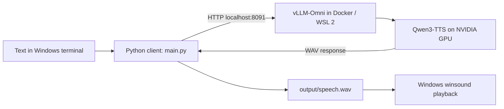

# Kaspar TTS demo

Type text in a Windows terminal, generate speech on your NVIDIA GPU, and play the audio on Windows.

This is Iman's standalone Python demo, developed with GPT assistance. The model and inference engine are third-party software downloaded separately.

## What runs where?



- **Windows** runs the client and plays sound.
- **WSL 2** supplies the Linux environment. No separate VirtualBox/VMware VM is needed.
- **Docker Desktop** manages the Linux container and GPU access.
- **vLLM-Omni** serves `Qwen/Qwen3-TTS-12Hz-0.6B-CustomVoice`.
- The client downloads the complete WAV before playing it. This is **not simultaneous streaming playback**.

## Before you start

Use Windows 11 with virtualization enabled, WSL 2, and an NVIDIA GPU supported by the CUDA runtime in the image. This project targets that configuration; it does not provide a CPU-only or macOS setup. The development GPU is an NVIDIA Quadro RTX 5000 with 16 GB VRAM. Available VRAM and other workloads affect model capacity; 16 GB is the reference hardware, not a certified minimum.

Allow substantial free disk space: the existing base image was reported as about 38 GB by Docker, and model downloads and build layers need additional space. The first run needs internet access and may take a long time. Later runs reuse the image and model cache.

## 1. Prepare Windows and WSL once

Skip components already installed. Windows installation may need administrator approval and a restart.

In **Administrator PowerShell**:

```powershell
wsl --install -d Ubuntu
```

Restart if requested. Open Ubuntu once and create your Linux username and password. Then check from PowerShell:

```powershell
wsl -l -v
```

Ubuntu must show version `2`. If it shows `1`, use `wsl --set-version Ubuntu 2`. See [Microsoft's WSL installation guide](https://learn.microsoft.com/en-us/windows/wsl/install).

Install the current NVIDIA **Windows** driver for your GPU. Do not install a separate Linux display driver inside WSL. See [NVIDIA's CUDA on WSL guide](https://docs.nvidia.com/cuda/wsl-user-guide/index.html).

Install [Docker Desktop for Windows](https://docs.docker.com/desktop/setup/install/windows-install/), start it, and select:

1. **Settings → General → Use the WSL 2 based engine**.
2. **Settings → Resources → WSL Integration → Ubuntu**.
3. Apply settings and use Linux containers.

Do not install a second Docker Engine inside Ubuntu for this setup. See [Docker's WSL backend guide](https://docs.docker.com/desktop/features/wsl/).

In **normal PowerShell**, install Git and uv if missing:

```powershell
winget install --id Git.Git -e
winget install --id astral-sh.uv -e
```

Open a new terminal afterwards. [uv installation reference](https://docs.astral.sh/uv/getting-started/installation/).

## 2. Get the demo

In **Windows PowerShell**, choose a folder for your code, then:

```powershell
git clone https://github.com/ImanSoratiAshtiani-Edu/TextToSpeech.git
cd TextToSpeech
```

The repository can live on any Windows drive. Scripts do not contain a developer-specific drive path.

## 3. Start the model server

From that repository folder in **PowerShell**, open Ubuntu at the same location:

```powershell
wsl -d Ubuntu
```

The following commands run in **Ubuntu / Bash**, not PowerShell. Check that `ls` shows `compose.yaml`, then:

```bash
docker version
docker compose version
nvidia-smi
bash scripts/server.sh start
```

The helper builds a local image, applies the embedding dtype fix, and starts the server in the background. Compose requests NVIDIA GPU access; see [Docker's GPU guide](https://docs.docker.com/compose/how-tos/gpu-support/).

The base image is pinned to the exact digest used during development. The patch is built into the image, so it moves with the application. Model files are downloaded to the Docker-managed volume `kaspar-tts-demo-hf-cache` and reused across starts. To reuse an existing Docker model-cache volume, set its name first:

```bash
export HF_CACHE_VOLUME=your-existing-huggingface-volume
bash scripts/server.sh start
```

Monitor startup:

```bash
bash scripts/server.sh logs
```

Wait for model initialization. `Ctrl+C` exits log viewing without stopping the server. Continue when the service status shows `healthy`:

```bash
bash scripts/server.sh status
```

## 4. Check speech generation, then run the client

Return to **Windows PowerShell** in the repository directory (type `exit` to leave Ubuntu).

```powershell
powershell -ExecutionPolicy Bypass -File .\scripts\client.ps1 -Check
```

This creates the Python environment using the committed lockfile, sends a short speech request, and checks that the response contains readable WAV samples. It does not play sound. Success starts with `PASS: WAV received`.

Run the interactive demo:

```powershell
powershell -ExecutionPolicy Bypass -File .\scripts\client.ps1
```

Type a sentence and press Enter. The client writes `output/speech.wav` and plays it. Type `exit` to quit. Each request overwrites the previous audio. The execution policy override applies only to that PowerShell process.

Equivalent commands without the helper:

```powershell
uv sync --locked
uv run --locked python main.py
```

## Everyday start and stop

Start Docker Desktop first. In **Ubuntu**, from the repository:

```bash
bash scripts/server.sh start    # create/start; reuse cached build layers
bash scripts/server.sh logs     # follow server messages
bash scripts/server.sh status   # inspect status
bash scripts/server.sh stop     # stop and release GPU memory; retain container
```

Use `bash scripts/server.sh down` to remove only this Compose project's container/network. The model-cache volume is retained. Automatic startup after Windows reboot is not configured; run `start` when needed.

Reserve port 8091 and enough GPU memory for the demo before starting it.

## Configuration

| Setting | Default | Where to change |
|---|---|---|
| Client URL | `http://localhost:8091/v1` | `main.py`: `base_url` |
| Published port | `8091` | Bash: `export TTS_PORT=8093` before `start`; also update client URL |
| Container port | `8000` | `compose.yaml`; keep command, mapping and health check consistent |
| Model | `Qwen/Qwen3-TTS-12Hz-0.6B-CustomVoice` | Both `main.py` and `compose.yaml`; another model may need different settings |
| Voice | `ryan` | `main.py` |
| Output | `output/speech.wav` | `main.py`, relative to the script |
| Request timeout | 300 seconds | `main.py` |
| Model cache | Docker volume `kaspar-tts-demo-hf-cache` | Bash variable `HF_CACHE_VOLUME` |

`api_key="EMPTY"` is a placeholder, not a real credential. The server port binds to localhost. Remote access and authentication are outside this demo's scope.

## Repository files

| File | Purpose |
|---|---|
| `main.py` | Original Windows CLI: input, API call, WAV save and playback |
| `pyproject.toml`, `uv.lock`, `.python-version` | Client dependencies and Python version |
| `Dockerfile` | Pinned image plus compatibility fix |
| `compose.yaml` | GPU, port, cache, server command and health check |
| `scripts/server.sh` | Repository-relative lifecycle helper, run in Ubuntu |
| `scripts/client.ps1` | Client setup and launch, run on Windows |
| `scripts/check_server.py` | Speech request and WAV validation |
| `scripts/patch_runner.py` | Guarded patch application during build |
| `patches/embedding-dtype.patch` | Human-readable two-line upstream difference |
| `.gitignore`, `.dockerignore`, `.gitattributes` | Exclude generated data; keep shell scripts LF-compatible |

VM disks, image archives, model weights, caches, and output audio remain outside the source repository.

## Reproducibility and attribution

The Docker base is pinned by digest; client packages are pinned in `uv.lock`. The Hugging Face model revision is not pinned. Windows/WSL/Docker/GPU-driver versions remain external prerequisites. This is a setup recipe, **not an offline snapshot or a claim that every host has been tested**.

The fix converts `req_embeds` to `inputs_embeds.dtype` before `index_copy_`; it does not always force float16. The original runner identifies Apache-2.0 and copyright belonging to contributors to vLLM-Omni. The complete upstream file is not redistributed. Model and container licenses remain those of their publishers.

References: [vLLM-Omni](https://github.com/vllm-project/vllm-omni), [Qwen3-TTS model](https://huggingface.co/Qwen/Qwen3-TTS-12Hz-0.6B-CustomVoice), [NVIDIA WSL guide](https://docs.nvidia.com/cuda/wsl-user-guide/index.html).
