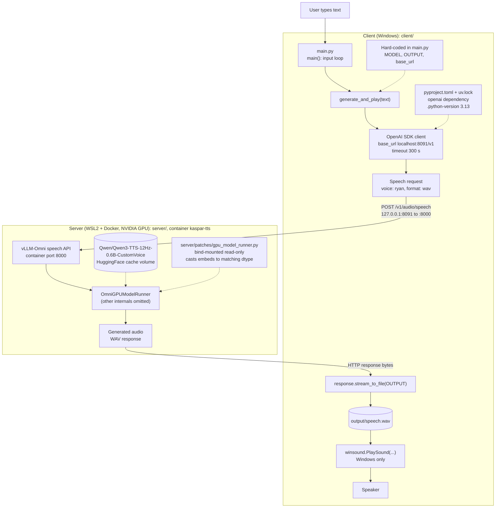

# iman-vllm-omni

A small text-to-speech demo for Kaspar. The server is vLLM-Omni running the
Qwen3-TTS model in Docker. The client is a console script that sends it a line of
text, saves the returned audio and plays it.

It has been run end to end on Windows with Docker Desktop (WSL2) and an NVIDIA GPU:
the server comes up with `docker compose`, and the client writes `output/speech.wav`.

```
iman-vllm-omni/
├── client/   console client (main.py, pyproject.toml, uv.lock)
└── server/   compose.yaml and the patched file for the container
```

## How it fits together



The server side is deliberately rough. Only the patched `OmniGPUModelRunner` was
looked at, the rest of vLLM-Omni is not drawn.

## Running it

Start the server (needs Docker and an NVIDIA GPU):

```
cd server
docker compose up -d
docker compose logs -f
```

The first start downloads the model, so give it a few minutes. When the log says the
server is listening, check it with `curl http://127.0.0.1:8091/v1/models`. Stop it with
`docker compose down`.

The port is only bound to 127.0.0.1. If you already have a HuggingFace cache you can
reuse it instead of the named volume:
`HF_CACHE=$HOME/.cache/huggingface docker compose up -d`.

The image is pinned by digest, it was the `omni-cuda` tag when this was set up:
`public.ecr.aws/deep-learning-containers/vllm@sha256:7e1f0b3cce437c5d857824de2c47716302143102ce18314acb70e3f9409a19d3`

Then the client:

```
cd client
uv sync
uv run python main.py
```

Type a sentence, the audio is saved to `output/speech.wav` and played.

## The patch

Without it the server failed in `OmniGPUModelRunner` because `req_embeds` and
`inputs_embeds` had different dtypes before `index_copy_` (around line 1740 of
`gpu_model_runner.py`). The fix casts `req_embeds` to the dtype of `inputs_embeds`.

`server/patches/gpu_model_runner-dtype.patch` is the diff. `gpu_model_runner.py` next to
it is the whole patched file, which `compose.yaml` mounts over the one in the image.
The patch applies cleanly to the original file and gives the patched file back exactly.
The original is the same size as the file in the image (109257 bytes); I have not
compared hashes.

## Things that are not done

- The client uses `winsound`, so it only plays audio on Windows.
- The `demo-tts` script entry in `client/pyproject.toml` still points at a placeholder
  function, not `main.py`.
- Mounting a whole file ties this to one image. A Dockerfile that applies the `.patch`
  at build time would fail loudly when the image changes instead of silently
  overriding newer code.
- No authentication on the server, and it is only reachable from the same machine.
