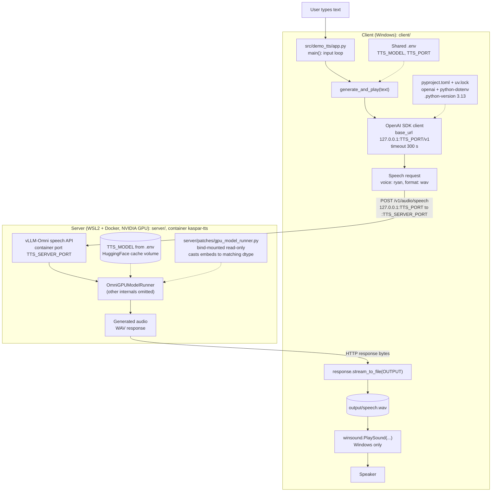

# iman-vllm-omni

A small text-to-speech demo for Kaspar. The server is vLLM-Omni running the
Qwen3-TTS model in Docker. The client is a console script that sends it a line of
text, saves the returned audio and plays it.

It has been run end to end on Windows with Docker Desktop (WSL2) and an NVIDIA GPU:
the server comes up with `docker compose`, and the client writes `output/speech.wav`.

```
iman-vllm-omni/
├── client/   console client (main.py wrapper, src/demo_tts/app.py, pyproject.toml)
└── server/   compose.yaml and the patched file for the container
```

## How it fits together



The server side is deliberately rough. Only the patched `OmniGPUModelRunner` was
looked at, the rest of vLLM-Omni is not drawn.

## Running it

Requirements: Windows for the client (`winsound`), `uv` with Python 3.13 or
newer, and Docker Desktop with WSL2 and NVIDIA GPU support for the server.
Run the demo commands below from `iman-vllm-omni/`, not the enclosing repository.

### Shared configuration

Copy the template once in PowerShell (keep an existing `.env`):

```powershell
Copy-Item .env.example .env
```

| Setting | Initial value | Used by |
| --- | --- | --- |
| `TTS_MODEL` | `Qwen/Qwen3-TTS-12Hz-0.6B-CustomVoice` | Server model and client requests |
| `TTS_PORT` | `8091` | Published host port and client URL |
| `TTS_SERVER_PORT` | `8000` | Container listener and port mapping |

Both sides use this one `.env`. The client finds it relative to its source,
regardless of the current directory. Shell environment variables override file
values in both tools. Restart the client and recreate the server with the `up -d`
command after changing settings. `.env` is ignored by Git; `.env.example` is the
tracked template. Changing `TTS_MODEL` does not guarantee another model supports
this client's fixed `ryan` voice or the pinned server image.

### Start the server

In a terminal at `iman-vllm-omni/`:

```powershell
docker compose --env-file .env -f server/compose.yaml up -d
docker compose --env-file .env -f server/compose.yaml logs -f
```

The first start downloads the model and initializes the engine. A running
container alone does not mean the API is ready. Wait for `Application startup
complete` in the logs. In another PowerShell terminal, check the API (use your
`TTS_PORT` value if you changed the initial port):

```powershell
Invoke-RestMethod http://127.0.0.1:8091/v1/models
```

The first speech request can also take longer while inference kernels compile.
The server is bound only to `127.0.0.1` and has no authentication.

The image is pinned by digest; it was the `omni-cuda` tag when this was set up:
`public.ecr.aws/deep-learning-containers/vllm@sha256:7e1f0b3cce437c5d857824de2c47716302143102ce18314acb70e3f9409a19d3`

The default cache is a named Docker volume. To reuse an existing HuggingFace
cache, set `HF_CACHE` in the shared `.env` to a host directory Docker can access.

### Start the client

In another terminal, start at `iman-vllm-omni/`:

```powershell
cd client
uv sync --locked
uv run demo-tts
```

`uv run python main.py` is an alternative; both commands run the same client.
Type a sentence to generate and play `client/output/speech.wav`. Each successful
request replaces this file. Type `exit` to quit.

If the client reports `Connection error`, check the API command above, the server
logs, and that both terminals use the same `TTS_PORT` (including any shell override).

### Stop the server

From `iman-vllm-omni/`:

```powershell
docker compose --env-file .env -f server/compose.yaml down
```

## The patch

Without it the server failed in `OmniGPUModelRunner` because `req_embeds` and
`inputs_embeds` had different dtypes before `index_copy_` (around line 1740 of
`gpu_model_runner.py`). The fix casts `req_embeds` to the dtype of `inputs_embeds`.

`server/patches/gpu_model_runner-dtype.patch` is the diff. `gpu_model_runner.py` next to
it is the whole patched file, which `compose.yaml` mounts over the one in the image.
The patch applies cleanly to the original file and gives the patched file back exactly.
The original is the same size as the file in the image (109257 bytes); I have not
compared hashes.

## Things that are not done

- The client uses `winsound`, so it only plays audio on Windows.
- Mounting a whole file ties this to one image. A Dockerfile that applies the `.patch`
  at build time would fail loudly when the image changes instead of silently
  overriding newer code.
- No authentication on the server, and it is only reachable from the same machine.
